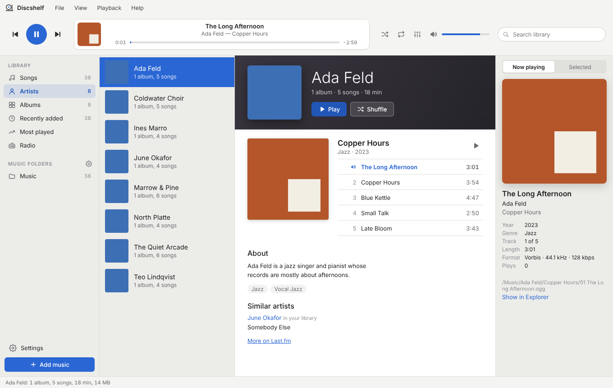
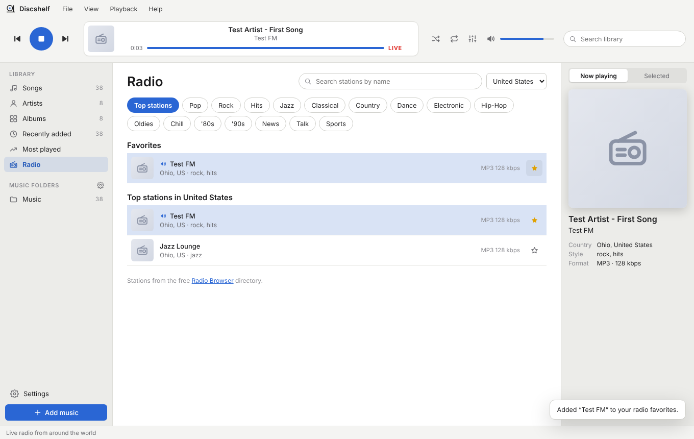
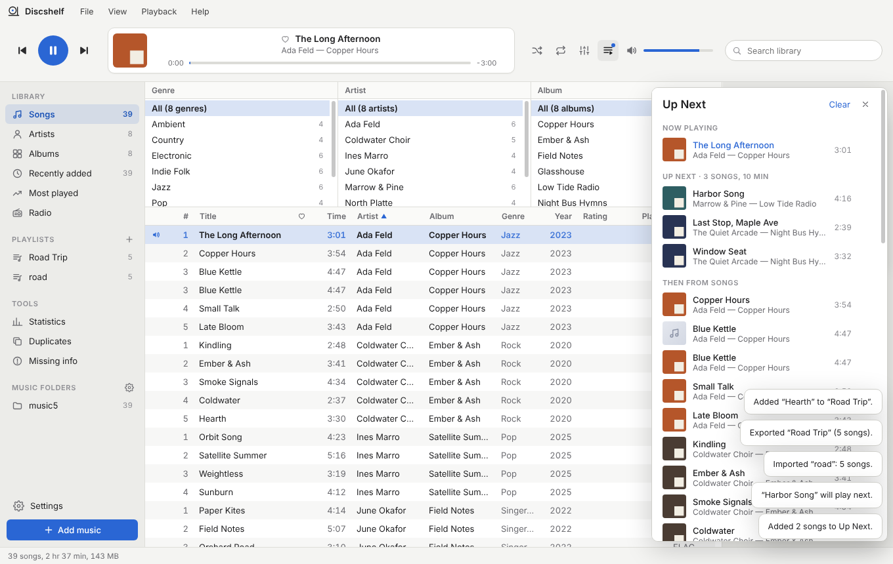
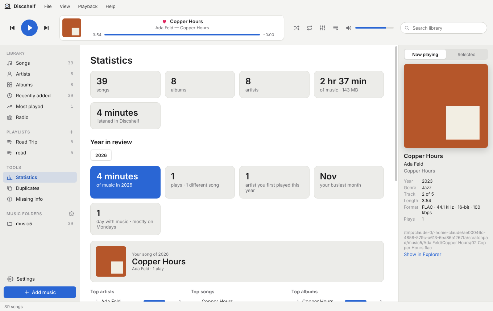
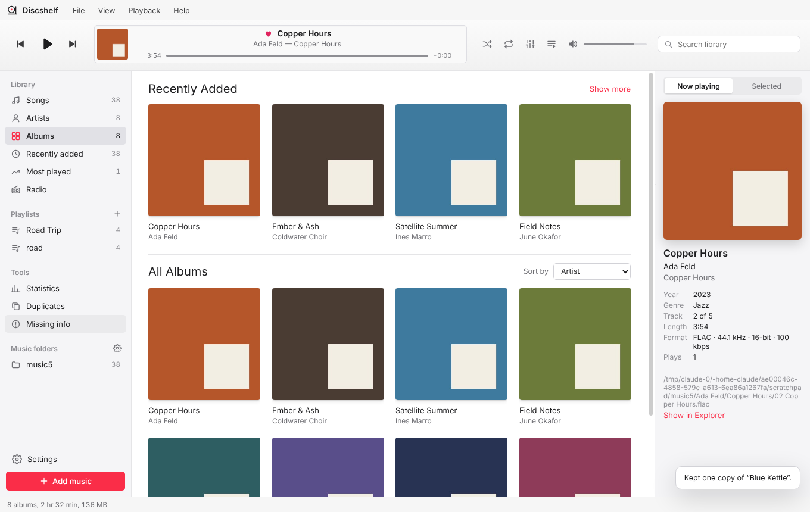
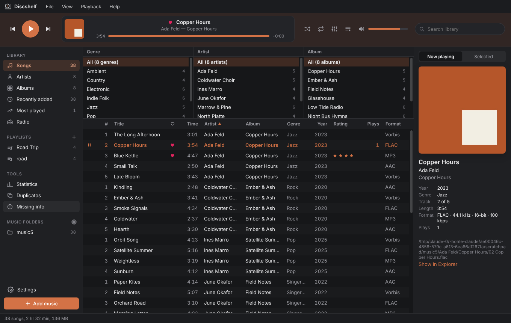

# Discshelf

A music player for the music on your computer, from Bytehawk Studio. It takes its layout from the classic Songbird media player: player controls and a "now playing" display across the top, your library on the left, Genre / Artist / Album filter panes above the song list, and album art on the right. Discshelf comes in **Modern**, **Classic** (Songbird colors) and **iTunes** styles, each in light and dark.


| Artists | Radio |
|---|---|
|  |  |
| **Up Next** | **Statistics** |
|  |  |
| **iTunes style** | **Album colors (dark)** |
|  |  |

| Classic light | Classic dark |
|---|---|
|  |  |
| **Modern light** | **Modern dark** |
|  |  |

## Download

**Windows 10/11:** get the latest release from [Releases](https://github.com/adamglassner/discshelf/releases/latest):

- `Discshelf-<version>-Setup.exe`: installer (installs for your user account, no admin rights needed)
- `Discshelf-<version>-win-x64.zip`: portable version (unzip, then run `Discshelf.exe`)

Discshelf is also listed in the **Bytehawk Studio Launcher**, which installs it and keeps it up to date.

The builds aren't code-signed yet, so Windows SmartScreen may say it "protected your PC". Click **More info → Run anyway**.

## What it does

- **Add music:** choose music folders (**File → Add Folder**, Ctrl+O), add single files, or drag folders and songs into the window. Discshelf finds **MP3, AAC (M4A), FLAC, Ogg Vorbis, Opus and WAV** files, reads their tags and cover art (embedded, or `cover.jpg` / `folder.jpg` next to the music) and adds them to your library. Your files stay where they are. New songs are picked up when Discshelf starts, or press **F5**.
- **Library:** Songs, Artists, Albums, Recently added, Most played, Radio, and one entry for each music folder.
- **Artists:** every artist with a photo; an artist page with their albums and songs, plus a bio and similar artists from Last.fm.
- **Albums:** an iTunes-style grid with Recently Added along the top and all your albums below. Open an album for its artwork and song list, then Play or Shuffle it.
- **Songs:** Genre → Artist → Album filter panes, a sortable song list (click a column header) and search (Ctrl+F).
- **Play:** double-click a song or press Enter. Play/pause, next/previous, seek, volume, shuffle, and repeat (all or one song). Your keyboard's media keys work too.
- **Playlists:** make them in the sidebar (Ctrl+N), drag songs, albums or artists onto them, drag to reorder, and import or export .m3u / .m3u8 files.
- **Up Next:** right-click and choose **Play Next** or **Add to Up Next**; the Up Next panel (Ctrl+U) shows what's coming and lets you reorder it.
- **Ratings and Loved:** stars and a heart for each song, saved into the files; loving a song loves it on Last.fm too.
- **Sleep timer:** stop after 15 minutes to 1½ hours (with a fade), or at the end of the song or album (**Playback → Sleep Timer**).
- **Tools:** **Statistics** (most played, listening time by month, year in review), **Duplicates** (keep the best copy) and **Missing info** (one-click fixes for missing artwork, genres, years and track numbers).
- **Equalizer:** 10 bands, preamp and presets (button in the player bar, or **Playback → Equalizer**).
- **Radio:** live stations from around the world (Radio Browser directory): top stations by country, genres, search, and favorites. Shows the song the station is playing.
- **Get Info** (Ctrl+I, or right-click a song or album): edit song details and artwork yourself, or look them up on iTunes and Deezer. Using an album result also gives each song its title and track number from the album's track list. **File → Find Missing Album Artwork** fills in covers for your whole library. Changes are saved into the music files (MP3, FLAC, M4A, Ogg, Opus, WAV); each file is checked after writing before it replaces the original. You can turn this off in Settings.
- **Last.fm:** connect your account in **Settings** to scrobble what you play, including songs on the radio when the station says what's playing.
- **Themes:** **Modern**, **Classic** (Songbird's look) or **iTunes** (white, like iTunes 12), each in light or dark or following Windows, with a choice of accent colors, or **Album colors** to tint Discshelf with the album that's playing (**Settings → Appearance**).
- **What's new:** **Help → What's New** shows your version, the changes in every release, and checks for updates.

Apple Lossless (ALAC) files are added to the library, but they can't be played yet.

Your library and settings are kept in `%APPDATA%\Discshelf` (**Settings → Open data folder**).

## Keyboard shortcuts

| | |
|---|---|
| Play / pause | Space |
| Next / previous song | Ctrl+→ / Ctrl+← |
| Volume up / down | Ctrl+↑ / Ctrl+↓ |
| Play selected song | Enter |
| Search | Ctrl+F |
| Go to the song that's playing | Ctrl+L |
| Add a folder / add files | Ctrl+O / Ctrl+Shift+O |
| Rescan library | F5 |
| Remove from library (or from the playlist you're in) | Delete |
| New playlist | Ctrl+N |
| Show / hide Up Next | Ctrl+U |
| Get Info | Ctrl+I |
| Settings | Ctrl+, |

## Building from source

You need [Node.js](https://nodejs.org/) 22 or newer.

```
git clone https://github.com/adamglassner/discshelf
cd discshelf
npm install
npm start          # run Discshelf
npm test           # tag reader and library tests
npm run dist       # build dist/Discshelf-<version>-Setup.exe and the portable zip (run this on Windows)
```

Discshelf is an Electron app with no other runtime dependencies. The tag reader (`src/main/tags/`) handles ID3v1/v2, FLAC, Vorbis comments, MP4 and RIFF INFO tags itself.

| Folder | What's in it |
|---|---|
| `src/main/` | Main process: window, menus, the `discshelf://` protocol that streams songs and artwork, library scanning |
| `src/main/tags/` | Reads tags, duration, format details and cover art from each file type, and writes details and artwork back (`writer.js`) |
| `src/main/online.js`, `src/main/lastfm.js`, `src/main/radio.js` | iTunes / Deezer lookups, Last.fm sign-in, scrobbling and artist info, the radio directory and stream relay |
| `src/renderer/` | The window: layout, themes, songs / artists / albums / radio views, Get Info, equalizer, settings, player |
| `test/` | Tests and small fixture files (`npm test`) |
| `design/mockups/` | Early design mockups for the desktop, mobile and server apps |

## Last.fm API key

Last.fm requires each app to have its own API key. To build it into the release:

1. Create an API account at <https://www.last.fm/api/account/create> (application name: Discshelf). You'll get an **API key** and a **shared secret**.
2. In this repository, go to **Settings → Secrets and variables → Actions** and add two repository secrets: `LASTFM_API_KEY` and `LASTFM_SECRET`.
3. The next release picks them up automatically.

Without them, Discshelf still works: Settings → Last.fm lets people enter their own key.

## Releasing

1. Update `version` in `package.json` and add a section to `CHANGELOG.md`.
2. Push to `main`. GitHub Actions runs the tests, builds the installer and portable zip, installs and starts both the way the launcher does, then publishes release `v<version>` with both files.

The Bytehawk Studio Launcher picks up the new release automatically. Its catalog entry downloads `Discshelf-*-win-x64.zip` and launches `Discshelf.exe`.

## Coming later

Gapless playback and crossfade, volume leveling, lyrics, a visualizer, ALAC playback, the Discshelf server, and the mobile and macOS apps. Design mockups for these are in [`design/mockups/`](design/mockups/) ([design canvas](https://claude.ai/artifact/HXFw1C7RiSvCq4xAK6p3ZG)).

---

© 2026 Bytehawk Studio
