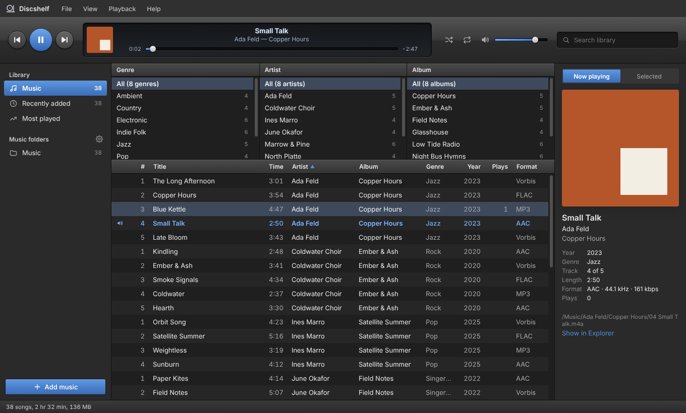

# Discshelf

A music player for the music on your computer, from Bytehawk Studio. It takes its layout from the classic Songbird media player: player controls and a "now playing" display across the top, your library on the left, Genre / Artist / Album filter panes above the song list, and album art on the right. Discshelf comes in **Light**, **Dark** and **Classic** (Songbird colors) themes.



| Light | Dark |
|---|---|
|  |  |

## Download

**Windows 10/11:** get the latest release from [Releases](https://github.com/adamglassner/discshelf/releases/latest):

- `Discshelf-<version>-Setup.exe`: installer (installs for your user account, no admin rights needed)
- `Discshelf-<version>-win-x64.zip`: portable version (unzip, then run `Discshelf.exe`)

Discshelf is also listed in the **Bytehawk Studio Launcher**, which installs it and keeps it up to date.

The builds aren't code-signed yet, so Windows SmartScreen may say it "protected your PC". Click **More info → Run anyway**.

## What it does (0.1.0)

- **Add music:** choose music folders (**File → Add Folder**, Ctrl+O), add single files, or drag folders and songs into the window. Discshelf finds **MP3, AAC (M4A), FLAC, Ogg Vorbis, Opus and WAV** files, reads their tags and cover art (embedded, or `cover.jpg` / `folder.jpg` next to the music) and adds them to your library. Your files stay where they are.
- **Library:** Music, Recently added, Most played, and one entry for each music folder. **F5** rescans: new and changed files are picked up and deleted files are dropped.
- **Browse:** Genre → Artist → Album filter panes, a sortable song list (click a column header) and search (Ctrl+F).
- **Play:** double-click a song or press Enter. Play/pause, next/previous, seek, volume, shuffle, and repeat (all or one song). Your keyboard's media keys work too. Discshelf remembers the last song and where you were.
- **Themes:** View → Theme → Follow Windows, Light, Dark or Classic.

Apple Lossless (ALAC) files are added to the library, but they can't be played yet.

Your library and settings are kept in `%APPDATA%\Discshelf` (**Help → Open Data Folder**).

## Keyboard shortcuts

| | |
|---|---|
| Play / pause | Space |
| Next / previous song | Ctrl+→ / Ctrl+← |
| Volume up / down | Ctrl+↑ / Ctrl+↓ |
| Play selected song | Enter |
| Search | Ctrl+F |
| Go to the song that's playing | Ctrl+L |
| Add a folder / add files | Ctrl+O / Ctrl+Shift+O |
| Rescan library | F5 |
| Remove from library | Delete |

## Building from source

You need [Node.js](https://nodejs.org/) 22 or newer.

```
git clone https://github.com/adamglassner/discshelf
cd discshelf
npm install
npm start          # run Discshelf
npm test           # tag reader and library tests
npm run dist       # build dist/Discshelf-<version>-Setup.exe and the portable zip (run this on Windows)
```

Discshelf is an Electron app with no other runtime dependencies. The tag reader (`src/main/tags/`) handles ID3v1/v2, FLAC, Vorbis comments, MP4 and RIFF INFO tags itself.

| Folder | What's in it |
|---|---|
| `src/main/` | Main process: window, menus, the `discshelf://` protocol that streams songs and artwork, library scanning |
| `src/main/tags/` | Reads tags, duration, format details and cover art from each file type |
| `src/renderer/` | The window: layout, themes, filter panes, song list, player |
| `test/` | Tests and small fixture files (`npm test`) |
| `design/mockups/` | Early design mockups for the desktop, mobile and server apps |

## Releasing

1. Update `version` in `package.json` and add a section to `CHANGELOG.md`.
2. Push to `main`. GitHub Actions runs the tests, builds the installer and portable zip, installs and starts both the way the launcher does, then publishes release `v<version>` with both files.

The Bytehawk Studio Launcher picks up the new release automatically. Its catalog entry downloads `Discshelf-*-win-x64.zip` and launches `Discshelf.exe`.

## Coming later

Playlists, a play queue, editing tags, ALAC playback, the Discshelf server, and the mobile and macOS apps. Design mockups for these are in [`design/mockups/`](design/mockups/) ([design canvas](https://claude.ai/artifact/HXFw1C7RiSvCq4xAK6p3ZG)).

---

© 2026 Bytehawk Studio
